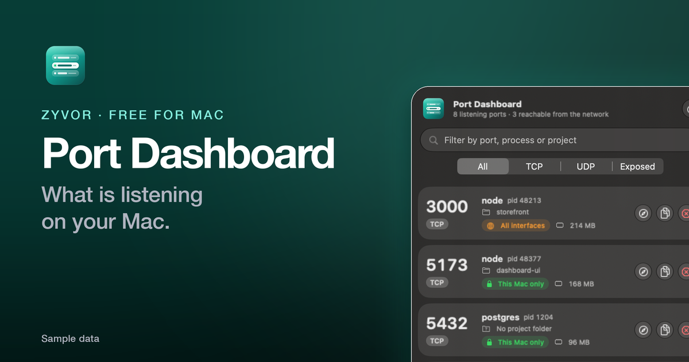
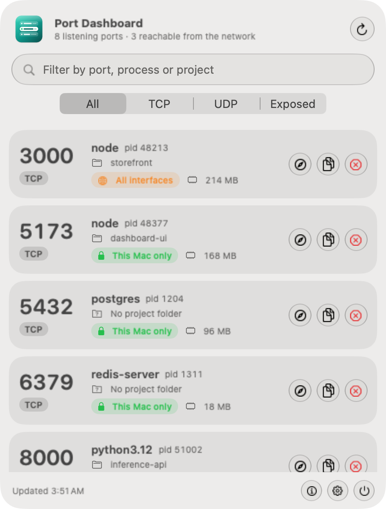
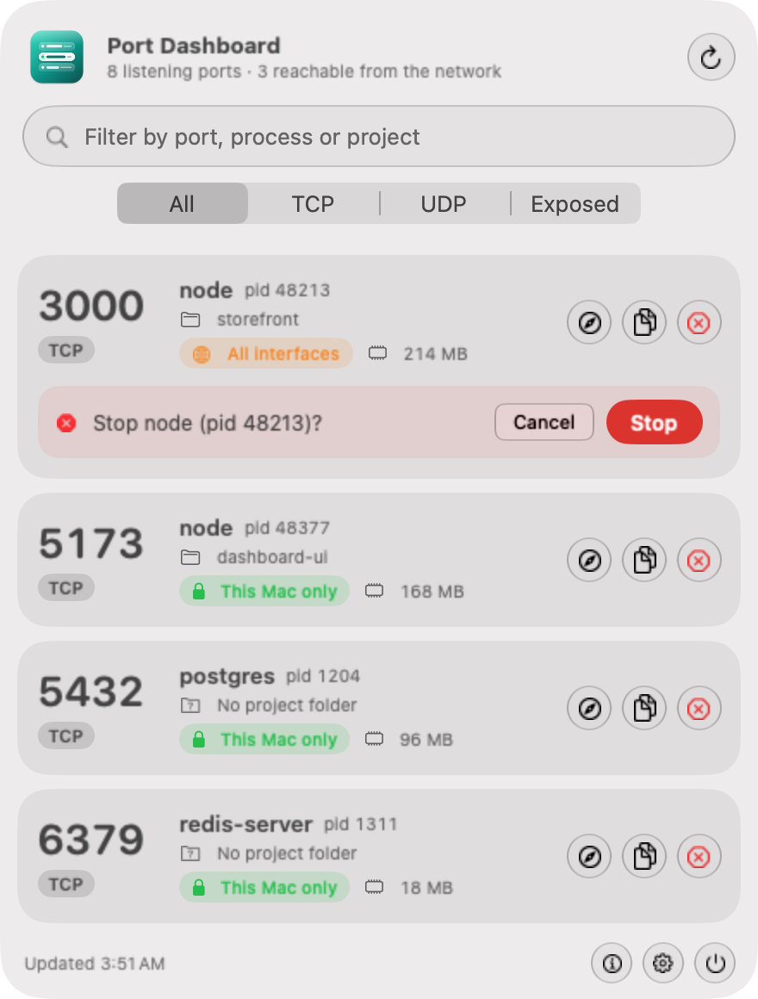
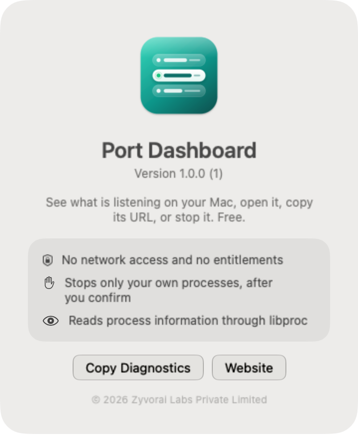
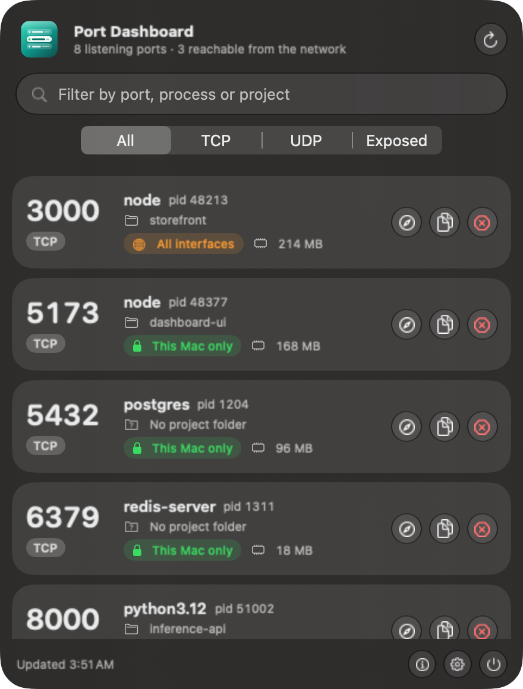
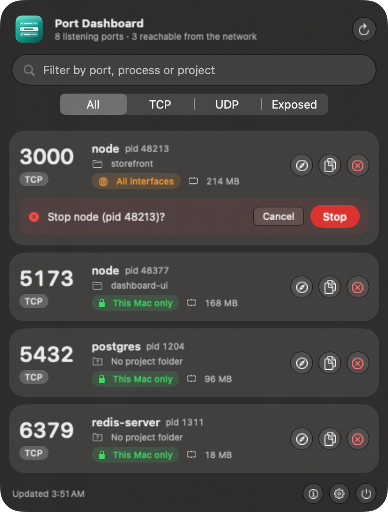
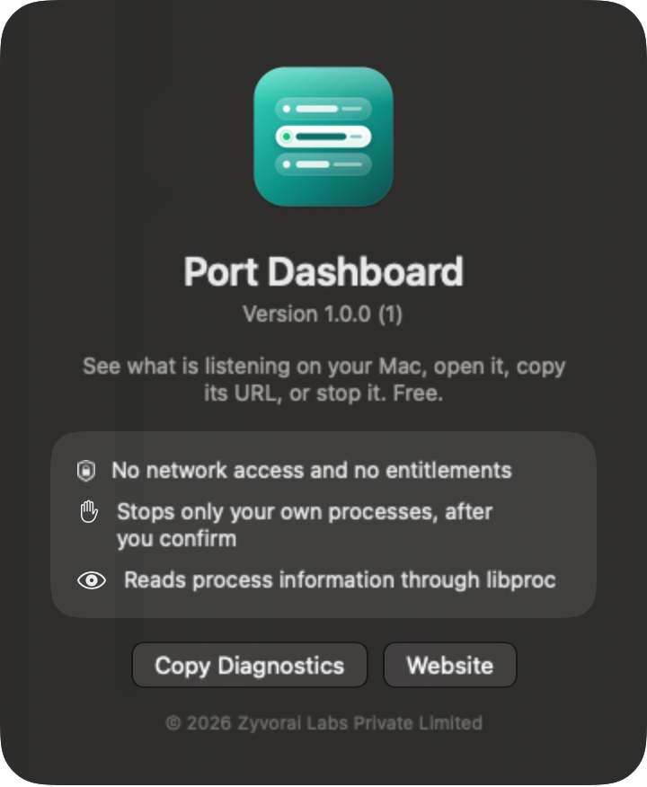

# Port Dashboard

### What is listening on your Mac.

A free menu-bar app that lists every listening TCP and UDP port with its process, project folder and memory. Open it, copy its URL, or stop it.

 

**[Download for Mac](https://github.com/zyvorai/port-dashboard/releases/tag/v1.0.0)** &nbsp;·&nbsp; [Website](https://zyvorai.github.io/port-dashboard/) &nbsp;·&nbsp; [Docs](docs/)

`PortDashboard-1.0.0.dmg` · free · macOS 27 or later · Apple silicon · signed and notarized

---

## Highlights

- **Every listening port, one list.** Listening TCP and bound UDP ports with the process and pid, the git project folder it runs from, its memory, and who can reach it. Refreshes every three seconds.
- **Find it fast.** Filter by port, process or project, or by All / TCP / UDP / Exposed.
- **Open and copy.** Open a TCP port in your browser or copy its URL.
- **Safe stop.** A confirmation, then SIGTERM. If the process is still running, a second confirmation before Force Kill (SIGKILL).
- **Native macOS 27.** Liquid Glass, light and dark, keyboard shortcuts, VoiceOver labels, Reduce Motion and Reduce Transparency respected.

## See it

*Rendered from the app's own views with invented sample rows (not a live capture of a running session).*

| Popover | Stop confirmation | About |
| --- | --- | --- |
|  |  |  |
|  |  |  |

## Download

| | |
| --- | --- |
| **Get it** | [Port Dashboard 1.0.0](https://github.com/zyvorai/port-dashboard/releases/tag/v1.0.0): `PortDashboard-1.0.0.dmg` and its `.sha256` |
| **SHA-256** | `c0f16033dbd21da1124898b22742a0ff22fa6b5503cce643cb0ab28d8a687bb6` |
| **Price** | Free. No licence key, no account. |
| **Requirements** | macOS 27 or later, Apple silicon |
| **Notarized** | Developer ID signed and notarized by Apple, so Gatekeeper opens it normally |

Install steps: [docs/INSTALL.md](docs/INSTALL.md).

## Privacy and safety

- **No network.** The app contains no network code and is signed with **no entitlements**.
- **No account, no analytics, no telemetry.** Nothing leaves your Mac. See [docs/PRIVACY.md](docs/PRIVACY.md).
- **Safe-kill guard.** Own-user processes only; never pid 0 or 1, never Port Dashboard itself, never when running as root. The process is re-checked by start time right before any signal, so a reused pid is never signalled. See [docs/HOW-IT-WORKS.md](docs/HOW-IT-WORKS.md).

## Limits

- Without administrator rights macOS exposes only this account's sockets, so services run by other users are not listed.
- It has been verified by its automated self-tests and a launch check. It has **not yet been clicked through by a human on a clean Mac**.

## Documentation

[Install](docs/INSTALL.md) · [How it works](docs/HOW-IT-WORKS.md) · [FAQ](docs/FAQ.md) · [Privacy](docs/PRIVACY.md) · [Uninstall](docs/UNINSTALL.md) · [Changelog](CHANGELOG.md)

## Licence

Port Dashboard is free to use for personal and commercial purposes. It is proprietary software: no redistribution, no reverse engineering, provided as is. See [LICENSE](LICENSE). This repository contains documentation and release downloads only; the source code is private.

&copy; 2026 ZYVORAI LABS PRIVATE LIMITED · [zyvor.dev](https://zyvor.dev)
